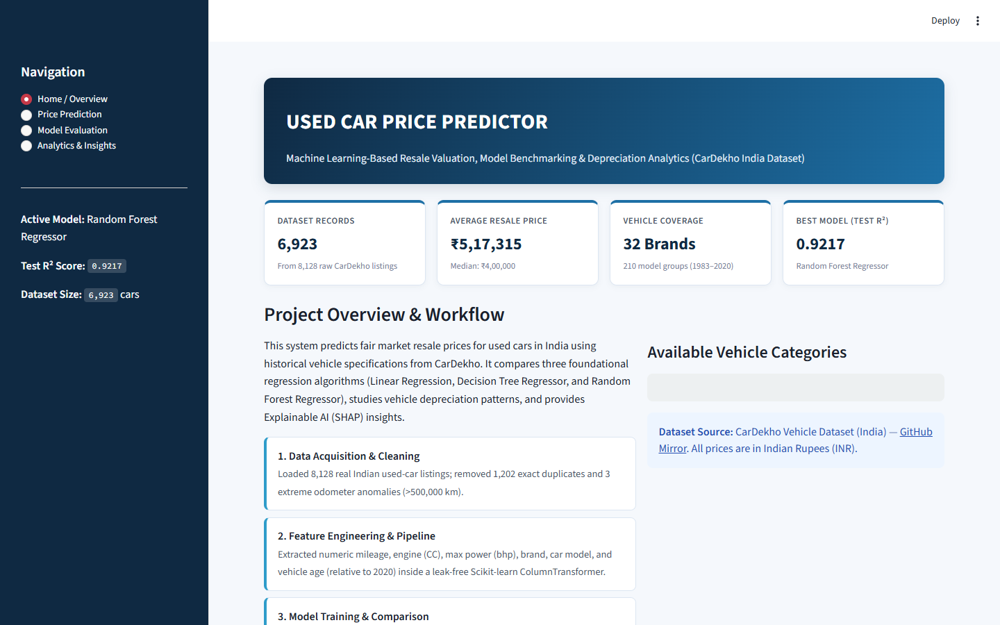
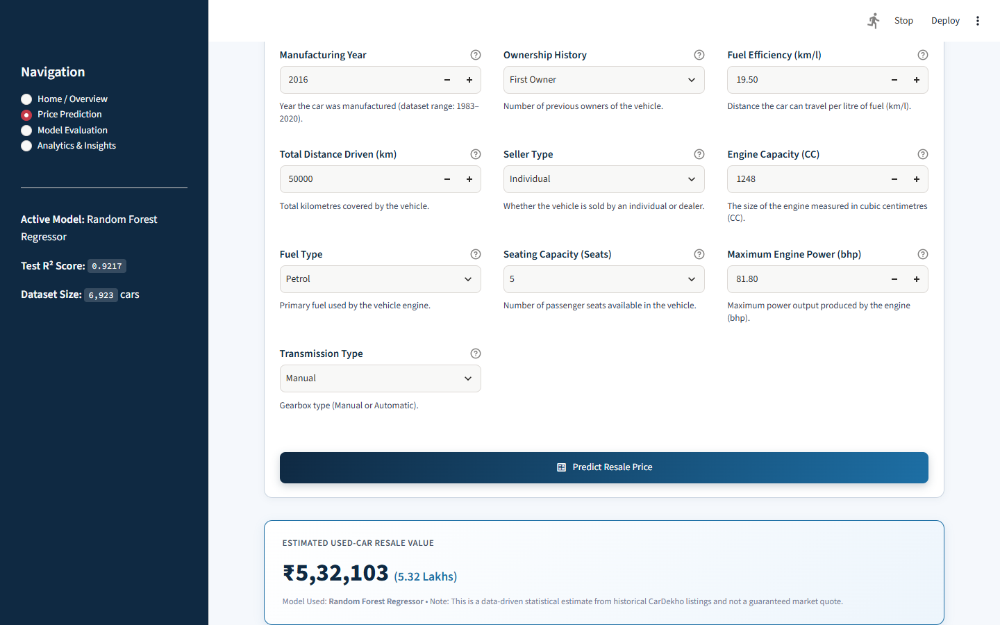
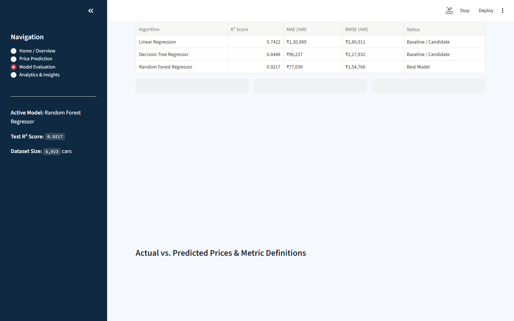
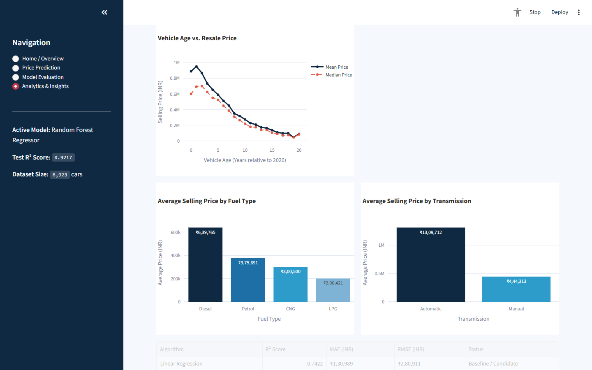

# Machine Learning-Based Used Car Price Prediction System

An end-to-end, explainable Machine Learning project that predicts fair market resale prices (in INR) for Indian used cars using historical vehicle specifications from CarDekho. Built for undergraduate Machine Learning evaluation with clean Scikit-learn pipelines, vehicle depreciation analysis, SHAP explainability, an interactive Streamlit dashboard, automated Pytest checks, and full academic documentation.

---

## Key Features

- **Resale Price Prediction:** Estimates fair used-car resale value in Indian Rupees (INR) from 12 vehicle attributes (`brand`, `car_model`, `year`, `km_driven`, `fuel`, `seller_type`, `transmission`, `owner`, `mileage`, `engine`, `max_power`, `seats`).
- **3-Algorithm Comparison:** Trains and benchmarks **Linear Regression** (baseline), **Decision Tree Regressor**, and **Random Forest Regressor** on the exact same 80:20 train-test split using **R²**, **MAE**, and **RMSE**.
- **Leak-Free Preprocessing:** Uses Scikit-learn `Pipeline` and `ColumnTransformer` (`SimpleImputer`, `StandardScaler`, `OneHotEncoder(handle_unknown="ignore", min_frequency=10)`) fitted strictly on training data.
- **Depreciation Analysis:** Visualizes price relationships across vehicle age (relative to 2020), odometer reading, fuel type, transmission, and top brands.
- **Explainable AI (SHAP):** Global feature impact (`shap.TreeExplainer` on 200 test samples) plus per-prediction local SHAP contributions inside the web dashboard.
- **4-Page Streamlit Dashboard:** Interactive UI with Home/Overview, Live Price Prediction, Model Evaluation, and Analytics & Insights.

---

## Technology Stack

- **Language:** Python 3.13
- **Machine Learning:** `scikit-learn` (LinearRegression, DecisionTreeRegressor, RandomForestRegressor, Pipeline, ColumnTransformer)
- **Data Processing:** `pandas`, `numpy`, `joblib`
- **Visualization:** `matplotlib`, `seaborn`, `plotly`
- **Explainability:** `shap`
- **Web Frontend:** `streamlit`
- **Testing & Documentation:** `pytest`, `nbformat`, `python-docx`, `reportlab`, `python-pptx`

---

## Dataset Source

- **Dataset:** Vehicle Dataset from CarDekho (`Car details v3.csv`)
- **Geographical Context & Units:** India — Selling Price in **INR (Indian Rupees)**
- **Raw Records:** 8,128 rows × 13 columns (Years: 1983–2020, 32 brands)
- **Cleaned Records:** 6,923 unique rows (after removing 1,202 exact duplicate listings and 3 extreme odometer anomalies `> 500,000 km`)
- **Acquisition URL:** `https://raw.githubusercontent.com/StatguyUser/feature_engineering_and_selection_for_explanable_models/main/Car%20details%20v3.csv`
- **Original Kaggle Reference:** `https://www.kaggle.com/datasets/nehalbirla/vehicle-dataset-from-cardekho`

---

## Project Directory Structure

```text
Used_car_price_prediction/
├── dataset/
│   └── used_cars.csv                         # Downloaded CarDekho dataset
├── notebooks/
│   └── 01_Exploratory_Data_Analysis.ipynb    # EDA notebook
├── models/
│   ├── best_model.pkl                        # Saved Random Forest Pipeline
│   └── model_metadata.json                   # Metrics, stats, XAI & chart metadata
├── src/
│   ├── __init__.py
│   ├── data_loader.py                        # Dataset loading & summary inspection
│   ├── preprocessing.py                      # Cleaning, feature engineering, ColumnTransformer
│   ├── train.py                              # Model training, selection & artifact export
│   ├── evaluation.py                         # Metrics, EDA & depreciation plots
│   ├── explainability.py                     # Feature importance & SHAP TreeExplainer
│   └── prediction.py                         # Input validation & inference API
├── app/
│   ├── app.py                                # 4-page Streamlit web dashboard
│   └── components.py                         # Custom navy/blue theme & UI cards
├── reports/
│   ├── charts/                               # EDA, evaluation, SHAP & UI screenshots
│   ├── Project_Report.docx                   # Academic report (Word)
│   ├── Project_Report.pdf                    # Academic report (PDF)
│   ├── Presentation.pptx                     # 10-slide presentation deck
│   └── Viva_Preparation.md                   # Viva Q&A (20+ questions) & speaking script
├── tests/
│   └── test_project.py                       # Automated pytest suite
├── requirements.txt
├── run.bat                                   # Windows one-click launcher
├── .gitignore
└── README.md
```

---

## ML Workflow

1. **Load & Inspect:** Read `dataset/used_cars.csv` and audit nulls/duplicates.
2. **Clean & Engineer Features:** Drop exact duplicates (`1,202`) and extreme odometer errors (`> 500,000 km`, `3` rows); extract numeric `mileage`, `engine`, `max_power`; treat invalid `0` mileage/power and `' bhp'` as `NaN`; drop inconsistent `torque`; extract `brand`, `car_model`, and `vehicle_age = 2020 - year`.
3. **Train-Test Split (80:20):** Split into `5,538` training and `1,385` test records (`random_state=42`) before fitting any preprocessing transformers.
4. **Train & Compare:** Fit Linear Regression, Decision Tree, and Random Forest inside identical `Pipeline` wrappers.
5. **Explain & Deploy:** Generate Gini feature importance, SHAP global/local explanations, charts, `models/best_model.pkl`, and serve via Streamlit.

---

## Model Evaluation Results (Held-Out Test Set, n = 1,385)

| Model | R² Score | MAE (INR) | RMSE (INR) | Notes |
| --- | ---: | ---: | ---: | --- |
| Linear Regression | 0.7422 | ₹1,30,989 | ₹2,80,911 | OLS linear baseline |
| Decision Tree Regressor | 0.8448 | ₹96,237 | ₹2,17,932 | `max_depth=12, min_samples_leaf=5` |
| **Random Forest Regressor** | **0.9217** | **₹77,039** | **₹1,54,766** | **Best Model** (`n_estimators=150, max_depth=18, min_samples_leaf=2`) |

---

## Windows Installation & Execution Instructions

### Option 1: One-Click Launcher (`run.bat`)
Double-click `run.bat` or run it from Command Prompt:
```cmd
run.bat
```

### Option 2: Manual Setup in PowerShell / Command Prompt
```powershell
# 1. Create and activate local virtual environment
python -m venv .venv
.\.venv\Scripts\Activate.ps1

# 2. Install required dependencies
pip install -r requirements.txt

# 3. (Optional) Re-run training, charts, and SHAP pipeline
python -m src.train

# 4. Run automated test suite
pytest -v

# 5. Launch the Streamlit web dashboard
streamlit run app/app.py
```

---

## Application Screenshots

| Home Overview | Live Price Prediction & SHAP |
| :---: | :---: |
|  |  |

| Model Evaluation | Depreciation & Insights |
| :---: | :---: |
|  |  |

---

## Known Limitations

- **Historical Cutoff (2020):** CarDekho listings in this dataset span up to 2020 (`vehicle_age` uses 2020 as the reference year); post-2020 inflation and newer EV models are not represented.
- **Physical Condition Not Included:** Service records, accident history, tire/paint wear, and city/RTO taxes are absent from the dataset.
- **Luxury Segment Variance:** High-priced luxury cars (> ₹25 Lakhs) are fewer in count, resulting in higher absolute rupee error tails (RMSE > MAE).
- **Advisory Estimates Only:** Predictions reflect statistical patterns in historical listings and do not constitute guaranteed market quotes.
